<!-- animated contribution graph: real data, boxes reveal cell by cell
     (regenerated daily by .github/workflows/update-profile-art.yml) -->

<h3><code>edgar@serverlys ~ $ ./contributions.sh</code></h3>

 
 

<!-- ascii portrait (left) + neofetch card (right). both svgs are 840x880
     so equal widths give equal heights.
     portrait: python scripts/prep_photo.py source-photo.jpg && python scripts/make_ascii_svg.py
     card:     python scripts/make_info_card.py -->

<h3><code>edgar@serverlys ~ $ whoami</code></h3>

<table>
<tr>
<td valign="top"></td>
<td valign="top"></td>
</tr>
</table>

 
 

<h3><code>edgar@serverlys ~ $ ./links.sh</code></h3>

<b>Founder · Full-Stack Engineer · AI Architect</b>

 
 

<h3><code>edgar@serverlys ~ $ ls ~/projects</code></h3>

<table>
<tr>
<td width="50%" valign="top">

### 🌐 Serverlys
**Hosting & AI Automation Platform**

Hosting infrastructure plus AI automation services, so businesses get both out of the box.

`Next.js` `Node.js` `Docker` `Stripe` `AI Agents`

[→ serverlys.com](https://serverlys.com)

</td>
<td width="50%" valign="top">

### 💬 ConvoAI
**AI Employees for Website Chat & WhatsApp**

Multi-tenant platform where AI agents answer customers in website chat and WhatsApp, capture leads, and hand off to humans in a shared inbox.

`Next.js` `TypeScript` `PostgreSQL` `WhatsApp API` `AI`

</td>
</tr>
<tr>
<td width="50%" valign="top">

### 🎙️ AI Voice Agents
**Autonomous Phone Agents for Businesses**

Voice agents that handle inbound and outbound calls, qualify leads, and book appointments with no human in the loop.

`Retell AI` `Cal.com` `n8n` `Twilio`

</td>
<td width="50%" valign="top">

### 🏢 Facility One Pro
**Business Automation & Web Solutions**

End-to-end digital solutions for facility management companies, from lead capture to scheduling and billing.

`React` `PHP` `Stripe` `Automation`

[→ facilityonepro.com](https://facilityonepro.com)

</td>
</tr>
</table>

 

<h3><code>edgar@serverlys ~ $ cat stack.txt</code></h3>

 
 

<h3><code>edgar@serverlys ~ $ ./contact.sh</code></h3>

Working on something ambitious with <b>AI automation</b> or <b>SaaS</b>? Let's talk.

 
 

